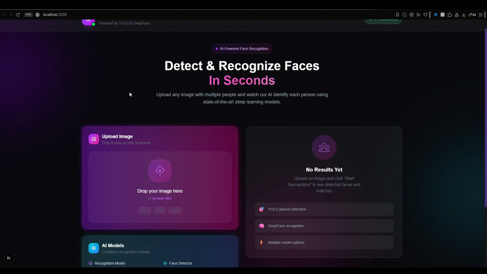

# Person Detection and Face Recognition

Finds the people in an image with **YOLO**, extracts their faces with **RetinaFace** / **DeepFace**, and identifies
each face by matching it against a database of known faces. The repo includes the research notebooks, evaluation of
both stages, and a web app to try it on your own images.



## How it works

```
Image ──► YOLO (person detection) ──► crop each person
                                          │
                                          ▼
                               Face detection (RetinaFace, OpenCV, MTCNN, …)
                                          │
                                          ▼
                         DeepFace.find(): match against the face database
                                          │
                                          ▼
                              Name + distance for each face
```

The face database is the [Pins Face Recognition](https://www.kaggle.com/datasets/hereisburak/pins-face-recognition)
dataset from Kaggle: 105 celebrities, one folder per person.

## Repository structure

```
rep/data_prep.ipynb                  # Download the Kaggle dataset and build img/data and img/test_images
src/
├── main.ipynb                       # Step-by-step pipeline: YOLO → RetinaFace → DeepFace
├── eval/
│   ├── deepface_eval/               # Recognition accuracy, per-person precision/recall/F1
│   └── yolo_eval_Data/              # Person detection evaluation (mAP, precision/recall curves)
└── web/
    ├── backend/                     # Flask API (app.py) and dataset setup script
    └── frontend/                    # Next.js + TypeScript + Tailwind UI
requirements.txt
```

Images, datasets and model weights are not committed. The notebooks download what they need.

## Setup

Requires Python 3.10+ and, for the web app, Node.js 20+.

```bash
python -m venv venv
venv\Scripts\activate        # Windows
# source venv/bin/activate   # Linux/macOS
pip install -r requirements.txt
```

The YOLO weights (`yolo11n.pt`) download automatically the first time Ultralytics loads them.

## 1. Prepare the data

Run [rep/data_prep.ipynb](rep/data_prep.ipynb). It downloads the dataset with `kagglehub` and creates:

- `img/raw_data/`: the downloaded images, one `pins_<name>` folder per person
- `img/data/train/` and `img/data/test/`: a split per person. `img/data/test/` is the face database the notebooks
  match against
- `img/test_images/`: images held out for testing

If `kagglehub` asks for credentials, create an API token in your Kaggle account settings and save it as
`~/.kaggle/kaggle.json`.

## 2. Run the notebooks

```bash
jupyter lab
```

- [src/main.ipynb](src/main.ipynb): the full pipeline on a test image. Run only the YOLO cells for detection, or
  the DeepFace cells for recognition.
- [src/eval/deepface_eval/DeepFace_Evaluation.ipynb](src/eval/deepface_eval/DeepFace_Evaluation.ipynb): overall
  accuracy and per-person precision, recall and F1, with plots of the best and worst identities and the most
  confused pairs.
- [src/eval/yolo_eval_Data/Yolo_Evaluation.ipynb](src/eval/yolo_eval_Data/Yolo_Evaluation.ipynb): evaluates YOLO on
  the [People Detection](https://www.kaggle.com/datasets/adilshamim8/people-detection) dataset. Plots are saved to
  `runs/detect/`.

Paths in the notebooks are relative to the notebook's folder. Adjust `test_image` and `db_path` if you move things.

## 3. Run the web app

The web app lets you upload an image, pick the recognition model (VGG-Face, Facenet, ArcFace, …) and the face
detector (opencv, mtcnn, retinaface, …), and see the annotated result.

```bash
# Terminal 1: backend on http://localhost:5000
cd src/web/backend
pip install flask flask-cors opencv-python pillow
python setup_data.py     # downloads the dataset from Kaggle and builds ./data/test
python app.py

# Terminal 2: frontend on http://localhost:3000
cd src/web/frontend
npm install
npm run dev
```

See [src/web/README.md](src/web/README.md) for the API (`/api/recognize`, `/api/analyze`, …) and troubleshooting.

## Tech stack

YOLO11 (Ultralytics), DeepFace, RetinaFace, scikit-learn, Flask, Next.js, TypeScript, Tailwind CSS.
