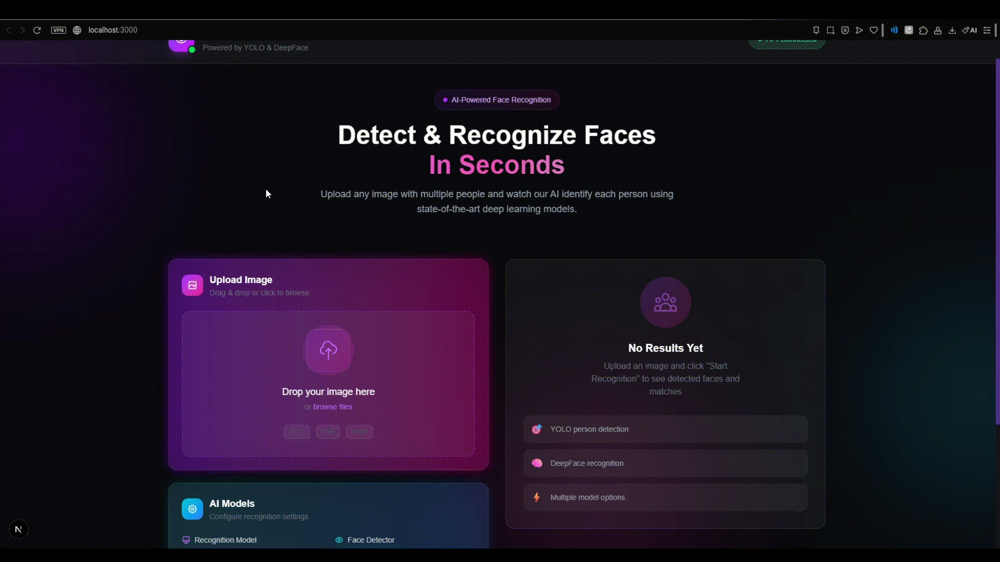

# Face Recognition Web Application

A full-stack face recognition application using **YOLO** for person detection and **DeepFace** for face recognition, with a **Next.js** frontend and **Flask** backend.

## Demo


## Architecture

```
┌─────────────────────────────────────────────────────────────┐
│                      Frontend (Next.js)                       │
│  - Image upload with drag & drop                             │
│  - DeepFace backend selector (VGG-Face, Facenet, etc.)       │
│  - Face detector selector (opencv, mtcnn, retinaface, etc.)  │
│  - Results visualization                                      │
└─────────────────────────────────────────────────────────────┘
                              │
                              ▼ HTTP API (localhost:5000)
┌─────────────────────────────────────────────────────────────┐
│                      Backend (Flask)                          │
│  1. Receive image + selected backends                        │
│  2. YOLO detects persons in the image                        │
│  3. DeepFace extracts faces from each person                 │
│  4. DeepFace matches faces against database                  │
│  5. Return results with bounding boxes and matches           │
└─────────────────────────────────────────────────────────────┘
```

## Project Structure

```
project_off/
├── frontend/                 # Next.js (TypeScript + Tailwind CSS)
│   ├── src/
│   │   ├── app/
│   │   │   └── page.tsx      # Main page
│   │   ├── components/
│   │   │   ├── ImageUpload.tsx
│   │   │   ├── BackendSelector.tsx
│   │   │   └── ResultsDisplay.tsx
│   │   ├── lib/
│   │   │   └── api.ts        # API client
│   │   └── types/
│   │       └── index.ts      # TypeScript types
│   └── .env.local            # Environment variables
│
├── backend/                  # Flask API
│   ├── app.py                # Main Flask application
│   └── requirements.txt      # Python dependencies
│
├── data/                     # Face database (created from notebook)
│   └── test/                 # Reference images for matching
│
└── yolo11n.pt               # YOLO model weights
```

## Setup & Installation

### 1. Backend (Flask)

```bash
# Navigate to backend directory
cd backend

# Create virtual environment (recommended)
python -m venv venv
venv\Scripts\activate  # Windows
# or: source venv/bin/activate  # Linux/Mac

# Install dependencies
pip install -r requirements.txt

# Copy YOLO model from parent directory
copy ..\yolo11n.pt .

# Start the Flask server
python app.py
```

The backend will run on `http://localhost:5000`

### 2. Frontend (Next.js)

```bash
# Navigate to frontend directory
cd frontend

# Install dependencies
npm install

# Start development server
npm run dev
```

The frontend will run on `http://localhost:3000`

## Usage

1. **Start the Flask backend** (Terminal 1):

   ```bash
   cd backend
   python app.py
   ```

2. **Start the Next.js frontend** (Terminal 2):

   ```bash
   cd frontend
   npm run dev
   ```

3. **Open the app** in your browser: http://localhost:3000

4. **Upload an image** with one or more people

5. **Select models**:
   - **Recognition Model**: VGG-Face, Facenet, ArcFace, etc.
   - **Detector Backend**: opencv, mtcnn, retinaface, etc.

6. **Click "Start Recognition"** to process the image

## API Endpoints

| Endpoint         | Method | Description                                    |
| ---------------- | ------ | ---------------------------------------------- |
| `/api/health`    | GET    | Health check                                   |
| `/api/backends`  | GET    | Get available backends                         |
| `/api/recognize` | POST   | Process image for face recognition             |
| `/api/analyze`   | POST   | Analyze face attributes (age, gender, emotion) |

### Example: `/api/recognize`

**Request:**

```json
{
  "image": "base64_encoded_image",
  "recognition_backend": "VGG-Face",
  "detector_backend": "opencv",
  "db_path": "./data/test"
}
```

**Response:**

```json
{
  "success": true,
  "persons_detected": 4,
  "recognition_backend": "VGG-Face",
  "detector_backend": "opencv",
  "results": [
    {
      "person_id": 0,
      "person_bbox": { "x1": 100, "y1": 50, "x2": 300, "y2": 400 },
      "person_confidence": 0.95,
      "faces": [
        {
          "facial_area": { "x": 20, "y": 10, "w": 80, "h": 100 },
          "face_confidence": 0.98,
          "recognition": {
            "name": "Celebrity Name",
            "distance": 0.32
          }
        }
      ]
    }
  ],
  "annotated_image": "base64_encoded_annotated_image"
}
```

## Available DeepFace Backends

### Recognition Models

- VGG-Face
- Facenet
- Facenet512
- OpenFace
- DeepFace
- DeepID
- ArcFace
- Dlib
- SFace
- GhostFaceNet

### Face Detectors

- opencv
- ssd
- dlib
- mtcnn
- retinaface
- mediapipe
- yolov8
- yunet
- fastmtcnn

## Face Database

For face recognition to work, you need a database of reference images:

1. Run the Jupyter notebook `AI_Models_&_Applications_.ipynb` to download the celebrity dataset
2. The dataset will be placed in `./data/test/`
3. Each subdirectory should contain images of one person

## Technologies Used

### Frontend

- Next.js 16
- TypeScript
- Tailwind CSS
- react-dropzone

### Backend

- Flask
- Flask-CORS
- OpenCV
- YOLO (Ultralytics)
- DeepFace
- NumPy
- Pillow

## Bonus — Web Server (demo)

A lightweight static web server is included here for quick demoing of the demo.gif and any static assets in this folder.

Run one of the following from the `src/web` directory to serve the files on port 8000:

```bash
# Python 3 (cross-platform)
python -m http.server 8000

# or using Node (if you prefer):
npx serve . -l 8000
```

Then open: http://localhost:8000

This is useful for quick previews or when you want to present the demo without starting the full frontend/backend stack.

## Troubleshooting

### Backend shows "offline" in the frontend

- Make sure Flask is running on port 5000
- Check if CORS is enabled
- Verify the YOLO model file exists

### Face recognition returns "No database"

- Run the Jupyter notebook to download the dataset
- Ensure `./data/test/` contains face images

### YOLO model not found

- Copy `yolo11n.pt` to the backend directory
- Or update the model path in `app.py`
